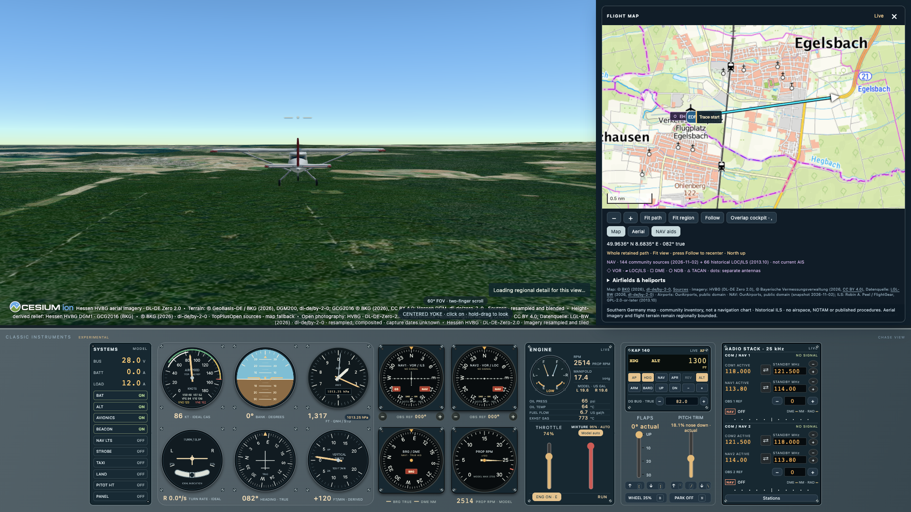

# Gefly

**Open a browser and fly.** Gefly aims to bring the most realistic flying
experience practical to anyone with a browser, a keyboard and a touchpad. Start
with the pleasure of “just fly,” then grow into instruments, navigation and
procedures, exercises for PPL and other small-plane licences, and later CPL
objectives.

Our vision is a **free, open-source flight-school community built around a
simulator**. Focus on fewer aircraft with deeper realism: controls, avionics,
flight physics, checklists and professional reference material that work together.
Begin with a classic-panel **Cessna 172 and EASA PPL**, with optional flight
controllers and more advanced cockpits as the experience grows.

Make the world part of learning. Fly over recognizable terrain, navigate with
real airports and radio aids, plan with maps and charts, and practise weather,
traffic and communication scenarios. Begin around Frankfurt and Hessen, then
expand through open DACH data and other regions. AI should help create sourced,
replayable flight experiences and realistic interactions.

Build it together: fly alongside other pilots, share exercises and debriefs,
and contribute aircraft, scenery, navigation data and learning material. Instructors,
flight schools and ecosystem partners can help shape the experience while the
platform stays open. **The free version stays free**; optional paid services may
support commercial maps and charts, hosting and AI features.

See the [vision and roadmap](docs/ROAD.md) for the full direction.



Live prototype flight near Egelsbach: systems switches and electrical gauges on
the far left, the latest cockpit panels, horizon and
actual flown trajectory on the right-side map.
[Screenshot provenance and credits](docs/images/README.md).

Today, Gefly is an experimental browser prototype with JSBSim flight dynamics,
CesiumJS scenery, MapLibre maps, classic instruments and flight review. The native
aircraft is a generic 172P research model; the planned project-owned 172S model,
complete learning experience and community features are still being built. No
training credit or validated aircraft fidelity is claimed. The first planned
exercise is a take-off, circuit and landing at Frankfurt-Egelsbach (EDFE), within
the EDDF/100 NM reference region.

The project uses TypeScript and reuses open physics engines and aircraft models
where practical, under **GPL-3.0-or-later**. See the
[training design](docs/design/TRAINING.md) and
[GeoFS-inspired control profile](docs/design/CONTROLS.md) for the learning and
interaction direction.

## Airport play

Open the flight map with **M**, choose **EDFE 26 or 08**, and select **Start at
runway**. The aircraft starts at rest with the engine idling and parking brake
set. Press **N** to release the brake, add power with **1–9**, and fly the circuit
manually. **Stop exercise** on the map pauses the flight and keeps Review available.
Other airports can be inspected, but their runway starts are not prepared yet.

Expand the runway's **north circuit** card for the practice objective and start
configuration. It logs sensed lift-off, touchdown, ground stop and collision
events, with available ground speed and contact vertical speed. **R** opens Review;
the card follows the selected recording time. These are observations, not a
landing grade or a validated C172S lesson.
**Save JSON** retains the declared EDFE runway so **Load JSON** restores this card
and its recorded observations. Older files without that context keep it unknown.
The card’s **Setup** tab compares actual controls with the simulator’s parked
start reference. **Events** shows the sensed flight log. Missing data and checks
the simulator cannot verify stay explicit; no aircraft settings change.

Sharp runway markings, taxiways and apron overlays sit on the public terrain.
Use **View → Terrain** or **Alt+Shift+J** (also **Options → Map terrain**) to drape official German cartography
without text over the terrain. Roads, fields, woodland, water and building
footprints extend beyond the airport; photography stays underneath while tiles
load or if the service fails. The flight map keeps its **Map/Aerial** background;
its **Map terrain** button changes only the 3D texture. **Practice PAPI / runway
lights** are separate illustrative aids, not a surveyed EDFE installation.
[Map terrain source and limits](docs/research/2026-11-04-label-free-map-terrain.md).

Select an airport on the map and open **Airport COM** to load a service into
**COM1/COM2 standby**, then swap on the radio stack. The directory contains 631
source records across 251 airports, including 8.33 channel names; it is a dated
community snapshot, not current operational information or an ATC service.
[Sources and limits](docs/research/2026-11-03-airport-play.md).

## Fly the prototype

```sh
npm --prefix app ci
python3 -m pip install -r utils/scenery/requirements.txt  # live photo compositing
just build-flight-engine   # first run: builds the local research runtime
just fly                  # http://127.0.0.1:5173
just stop                 # stop this checkout's flight server
```

Select **Start flight**, then click the scene for touchpad yoke control or use the keyboard.
The top menu/title bar and floating flight controls start hidden: **I** toggles
the menu, **O** opens Options, and **Alt+Shift+F** shows the flight controls. **F** toggles browser fullscreen (also in View); the browser’s **Esc** action exits it. Floating controls, map,
flight-data and stall-awareness panels are half opaque until clicked; their
first click activates the panel, and subsequent gestures operate it.
Arrow keys control pitch/roll, Q/W rudder, 0 throttle idle and 1–9 throttle.
In Review, **← / →** seek backward/forward one second, with repeated keys supported. **Continue live** flies from the selected frame and keeps the earlier path; **Back to live** returns to the original flight. Continuation starts a new simulation branch; older recordings without enough state remain viewable.
**=** or the replay speed button cycles **1×, 1.5×, 2×, 5×, 10×**, independently
of live-flight speed. The overlay shows **REPLAY** speed.

Space pauses, R opens Review, V changes view, E toggles the engine and S toggles
sound (initially off). **A** captures current heading/altitude with the autopilot;
**=** cycles **1×, 1.5×, 2×, 5×, 10×**, with an on-screen simulation-rate indicator.
These are simulator conveniences; acceleration preserves the fixed physics step
and the achieved rate depends on available CPU/rendering capacity.
Restart is in Flight. The last live location is saved locally and restored paused on reload; Restart clears it. Airborne restores use the normal 90 kt launch speed, rather than a saved physics checkpoint. Click toggles touchpad yoke control;
hold-drag retains the view where you release it and preserves the yoke midpoint;
Double-click the scenery or press Escape to center the view. L/R/U/D/B markers
show the aircraft’s left, right, up, down and backward directions. Two-finger
vertical scroll over the scenery changes field of view. Over the cockpit panel,
scroll up to focus on instruments around the pointer (up to 3×). The panel stays
the same size while the enlarged content is cropped inside it; horizontal scroll
moves between columns. Drag the panel background or a header to reach enlarged
controls above, below or to either side; operating controls does not move the
panel. Double-click panel housing or a noninteractive instrument
face to restore normal fit. Scroll down or resize also restores the fit.
Press **.** to cycle floating OSM names: **Off → Places → Landmarks → Detailed**.
The same setting is in View. Labels sit above their mapped locations on either
map terrain or photography; source coverage and label density are bounded.
With labels on, **right-click** terrain (Mac **Ctrl-click** also works) to look
for its nearest mapped name. The popup shows distance; it is not an address lookup.

Public terrain now streams across **7.00–10.00°E / 49.25–51.50°N**, including
Westerwald, the Lahn valley, Marburg and Kassel, alongside Darmstadt, Odenwald
and Spessart, with named Flight-menu demonstrations. The
bounded 200 m BKG relief surrounds the finer Egelsbach–Frankfurt–Taunus package;
it is not surveyed runway terrain or the full EDDF/100 NM region. Bundled
approximately 1.5–3 m imagery around Frankfurt is complemented by live public
Hessen, Bavarian and Baden-Württemberg photography and a map fallback. The generic
research aircraft remains experimental; see
[setup, controls and limitations](app/README.md).

Flight map → **Charts** opens the official OpenFlightMaps Germany VFR viewer
and DFS AIP airport/approach chart access, with the selected airport identifier.
Charts remain publisher-hosted; an embedded aeronautical overlay is not included.

**N** toggles the parking brake beside the **B** wheel-brake button.
Touchpad and keyboard bank input also steer the rudder/nosewheel by default.
Options → **Link rudder to aileron** can disable this assistance;
Q/W manual rudder takes priority. Rudder also steers the nosewheel on the ground.
Options → **Centered touchpad controls** fixes neutral at the flight-view center.
Both touchpad modes retain the camera angle after hold-drag.

For runway practice, **Circuit guide** adds a generated north-circuit schematic
for EDFE 08/26; **Fit circuit** shows all five legs. The nearest-leg readout uses
the selected live or recorded position. This is a practice aid, not a published
route or an altitude, speed or obstacle-clearance instruction.

**M** or **View → Flight map** opens a right-side map beside the 3D view,
showing the aircraft, whole retained flight path and **731 searchable
community airfield and heliport entries across five southern German states**, including available airport elevations. Choose the
public map or aerial imagery; a nautical scale and **community radio beacons and historical LOC/ILS
references (2013.10)** provide source-marked practice context. Pan/zoom,
select an airport and use Follow to return to the aircraft; selection does not
move the aircraft. During **Review**, the marker follows the selected historical
state. The map is practice context, not a navigation chart or current airport reference.

The local development server fetches live map/photo tiles from fixed public
WMS services. Pillow is needed for photo compositing; provider failure leaves
map/other scenery fallback. Hosting remains undecided: a static UI build alone
does not supply the development scenery proxy or local research engine.

The altimeter's **pressure window** opens paused pressure practice. Compare QNH,
launch-point QFE and standard pressure, or adjust the setting manually in hPa or
inHg. The ideal indication follows engine static pressure; launch QFE is a
practice reference, not airport elevation. Review retains the recorded setting.

The left **Systems** panel adds BAT/ALT, avionics, light and pitot-heat buttons,
with digital bus volts, battery amps and load. **MODEL** marks simplified electrical
estimates; these controls do not yet drive native avionics outages, icing or external
lights. Switch positions are recorded for Review. On narrow screens use the collapsed
**Aircraft systems** panel button or **Alt+Shift+Y**.

The classic **six-pack** now shows airspeed, attitude, pressure altitude, ideal
turn/slip, true heading and vertical speed. Click the scene to toggle touchpad
yoke control; hold-drag to look around. Two-finger vertical scrolling
over the scenery adjusts camera FOV; over the cockpit it zooms the panel around
the pointer. **[ / ]** selects flaps, **B** holds
wheel brakes, and **1–9** selects 10–90% throttle (**0** idle). The engine panel
adds mixture, RPM, manifold pressure, oil and fuel readouts. **Flight → Weight & fuel** (**Alt+Shift+W**) sets occupants, baggage, auxiliary load and initial fuel in litres; Apply restarts the flight. Fuel use reduces both tank contents and native aircraft mass. **P** toggles the two-axis autopilot. Its KAP 140 operating controls include VS,
current-altitude hold, selected-altitude capture and source-aware navigation;
generic servo response and real navigation-data coverage remain limited.
To climb to a preselected altitude, engage AP, set climb power and select the altitude. Selection automatically arms capture: **ARMED** and **ALT ARM** confirm it. Pressing **ARMED** cancels capture. Switch ALT to VS if needed, then use UP/DN to set the rate. The first press reveals a hidden VS value; subsequent taps change 100 FPM. Hold **CWS** to hand-fly and release to capture current VS or held altitude. CWS is an optional KAP140 control; this particular C172 installation is unverified.

On narrow screens, open **Engine & autopilot** for those controls.

**Radio stack → Stations** loads a historical Rhein-Main VOR/LOC/DME frequency into
NAV1 or NAV2 standby; swap to activate it. **Flight → EDDF 25C ILS practice** starts
near the sourced localizer/glideslope with NAV1 111.55 and FFM on NAV2 114.20.
Hold AP for a quarter second, select APR and start flight to try capture.
The bundled **2013.10** inventory is historical simulator data, with approximate
signals and missing/ambiguous services flagged; it is not current flight information
or a published approach. See [provenance](app/public/navdata/README.md).

## Status and entry points

Technical foundation is underway, with [native](studies/e1-jsbsim/README.md) and
[browser](studies/e1-browser/README.md) studies, selected stack, source-value
manifests and draft model/exercise contracts. Their recorded results retain the
reference-device, workload and source-applicability limits; they do not validate
172S behavior. Start with [the concept](docs/design/CONCEPT.md),
[specification](docs/SPEC.md), [open questions](docs/GAPS.md) and
[next tasks](docs/TODO.md).

The [bootstrap guide](docs/BOOT.md) is adapted from `../propeller/docs/BOOT.md` and extended with nine roles. [AGENTS.md](AGENTS.md) governs contributions; [the agent workflow](docs/agents/README.md) explains dispatch, ownership, parallel work and review. Native Codex definitions are in `.codex/agents/`; their role instructions are in `docs/agents/`. The additional [peer](docs/agents/peer.md) routes Codex-authored work to Claude and Claude-authored work to Codex for independent quality and specification review, with a reciprocal Claude dispatcher in `.claude/agents/peer.md`.

## Local commands

```sh
just ci                    # shared offline gate: scaffold, repository-tool tests, tracked whitespace
just check                 # scaffold, links and agent configuration checks; Python 3.11+
just test-tools            # lower-level offline repository-tool tests
just peer-preview codex packet.md  # inspect the external Claude route without a call
just docs                  # A4 PDFs alongside Markdown; pandoc and Google Chrome
just pdf docs/IDEA.md      # build one document
just reqs                 # requirement declarations
just assure check         # offline lineage/evidence integrity checks
just assure report        # planned/implemented/evidence/acceptance summary
just assure trace R-AIR-1  # trace a stable identifier
just assure diff main     # lineage changes against a Git revision
just assure impact docs/design/FDM-172S.md  # declared downstream effects
just assure-test          # assurance tool tests
just test-training        # bounded assessment-airspeed mapper and adapter tests
just lineage              # JSON + Markdown under ignored utils/assure/out/; no browser
just clean                # remove generated document outputs
```

The shared gate runs without `just`, from any caller directory:

```sh
python3 /path/to/checkout/utils/ci/run.py
```

It requires **Python 3.11+, Git and Node.js 24.2+**, resolves the checkout from the runner's location and combines scaffold,
repository/study tests, aircraft-data validation, assurance integrity, synthetic
rendering and tracked-content whitespace checks. Python, Git and the documented
Node/tool dependencies are listed in [SBOM](docs/SBOM.md). It fails on a
missing/empty required test suite or a required check failure. Whitespace checks
inspect every tracked current file, including in a clean checkout; untracked files
enter that check only after `git add`. The gate installs no project packages and
does not invoke review providers or document renderers.

The [GitHub Actions workflow](.github/workflows/foundation.yml) uses the same runner for
pushes and pull requests targeting `main`, on `ubuntu-24.04` with Python 3.11 and
3.15 plus an explicit Node 26 line. It uses pinned actions, a read-only contents token and no persisted checkout
credentials. These supported minor lines allow newer patch releases; observed
versions and local versus hosted outcomes belong in [RESULTS](docs/RESULTS.md).
Workflow configuration or a local pass does not establish a successful hosted run.

Use `just --list` for all recipes. Study build/serve/test commands are documented
with each study; there is no complete learner-app build or development server.
The shared gate covers the implemented foundation tooling; optional-dependency
study skips remain explicit and do not count as executed physics evidence.
[Foundation TODO 1.1](docs/TODO.md#1-foundation) remains open for further
stack-specific lint, types, vulnerability/license checks and runtime tests.
Acceptance of this slice follows [E0-CI](docs/EVAL.md#e0-ci-are-repository-tool-quality-gates-reproducible-locally-and-in-ci)
and independent reviews. [Assurance criteria AS1–AS8](docs/assure/SPEC.md) govern
the generated lineage/evidence checks: planned work is distinct from acceptance,
and skipped/stale evidence cannot support an accepted claim. Semantic/source and
numerical review remains manual. `just lineage` produces disposable JSON and
Markdown under ignored `utils/assure/out/`; it does not open a browser. Generated PDFs
are also ignored by Git. See
[utilities](utils/README.md) and [dependencies](docs/SBOM.md) for tool requirements,
action/update policy and document build limitations.

## Document map

| Document | Purpose |
| --- | --- |
| [IDEA](docs/IDEA.md), [CONCEPT](docs/design/CONCEPT.md), [TRAINING](docs/design/TRAINING.md), [SPEC](docs/SPEC.md) | Purpose, model, learner journey and requirements |
| [ARCH](docs/ARCH.md), [SEC](docs/SEC.md) | Components, trust boundaries and security |
| [EVAL](docs/EVAL.md), [RESULTS](docs/RESULTS.md) | Evaluation protocols and observed evidence |
| [TODO](docs/TODO.md), [ROAD](docs/ROAD.md), [DONE](docs/DONE.md) | Work, phases and progress |
| [GAPS](docs/GAPS.md) | Decisions, questions and assumptions |
| [SDLC](docs/SDLC.md), [STYLE](docs/STYLE.md), [SBOM](docs/SBOM.md) | Development and dependency conventions |
| [Research](docs/research/README.md), [assurance](docs/assure/ASSR.md) | Sources and requirement traceability |
| [Input](docs/input/README.md), [BOOT](docs/BOOT.md) | Original brief and setup method |

## Layout

```text
.codex/agents/       native Codex role registrations
docs/agents/        canonical role instructions and handoff templates
docs/               product, process, research and planning records
app/                reserved web application boundary
packages/           contracts, simulation, aircraft, avionics and training boundaries
data/               aircraft/source manifests; no unlicensed manuals or scenery
tests/              future reference fixtures, physics and acceptance checks
studies/            bounded technical and learning experiments
utils/ci/           shared CI runner, scaffold checker and their tests
utils/assure/       generated lineage/evidence checks; disposable out/ outputs
utils/              peer review, validators and document build assets
```

The first runtime foundation is the bounded assessment-airspeed mapper and
repository-data adapter in `packages/training/`, with shared types in
`packages/contracts/`. `just test-training` runs its offline tests. It supplies
evaluator-derived IAS from the existing calibration points; connecting it to the
experimental browser application and completing the validated exercise remain future work. Study and repository
tool implementations live under `studies/` and `utils/`. The initial
public repository destination is [gregoryyy/gefly](https://github.com/gregoryyy/gefly),
selected under the user's publication instruction. Gefly is licensed
**GPL-3.0-or-later** ([LICENSE](LICENSE), GAPS Q5). Third-party material keeps its
own license; see the [upstream notices](THIRD_PARTY_NOTICES.md) and [SBOM](docs/SBOM.md).
